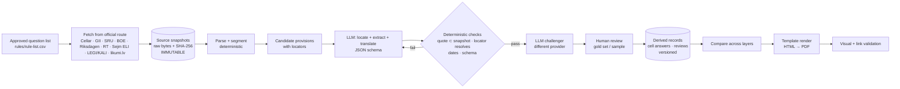

# F. Architecture options, recommendation and evidence-preserving data model

*14 October 2026. No architecture was built or deployed. Costs referenced here come from [`models/cost_model.py`](models/cost_model.py).*

## F.1 Three options compared

**Option 1: Proposed self-hosted n8n stack.** One rented EU server (4 vCPU / 8 GB, ~€36/month, UNVERIFIED [S55]) running n8n + Postgres + Redis + Gotenberg + Caddy, with models via OpenRouter, a private GitHub repo and Obsidian.

**Option 2: Code-first hybrid.** Python scripts in a git repo, a database (SQLite in the pilot, Postgres later if concurrency demands it), a scheduler (cron or GitHub Actions) only when update monitoring starts, and HTML→PDF rendering in code.

**Option 3: Minimal pilot.** The same code-first pieces as Option 2, but on the owner's own PC. No server, no scheduler, no database server: SQLite or CSV/JSON files + git, a manual review workflow in Markdown/CSV, PDF from local HTML.

| Criterion | 1. n8n stack | 2. Code-first hybrid | 3. Minimal pilot (local) |
|---|---|---|---|
| Fit for ~1,000 cells | Workable, but the visual flows get unwieldy for 10 source formats × 8 stages | Good | Good for 200 cells; adequate for 1,000 run as batches |
| Reproducibility | Weak: flow versions live in the n8n database unless exported; node upgrades change behaviour | **Strong:** code + config + prompts in git; runs are re-executable | **Strong** (same as 2) |
| Versioning and provenance | Needs custom work | Native: git + content hashes | Native |
| Human-review workflow | Needs a separate UI or forms | Markdown/CSV review files in git, later a small review UI | Markdown/CSV in git |
| Failure recovery | n8n retries per node; state in Postgres | Idempotent stages keyed by (cell, stage, input hash): rerun skips done work | Same |
| Update monitoring | Native cron triggers | cron/Actions polling of official change feeds (ES, EE, PL, DK APIs) | Manual rerun (acceptable in a pilot) |
| Observability | n8n execution log | Structured run log (JSONL) per call: model, provider, tokens, cost, latency | Same |
| Security | Internet-facing server: patching, TLS, auth, secrets on a box | Secrets on one machine or in the CI secret store | Smallest surface: no public endpoint |
| Backup and restore | DB + volumes + server image | git remote + DB file | git remote |
| Maintenance burden | **Highest:** 5 services to patch | Medium | **Lowest** |
| Vendor lock-in | n8n licence is source-available, internal-use only [S44] | Low | Low |
| Scaling limit | One box | Can move to a VM or CI later | Single PC |
| Expected infra cost | ~€36/month (UNVERIFIED) + backups | €0 to low (CI free tiers not verified) | **€0** |
| Operator skill | n8n + Linux admin + Docker | Python + git | Python + git (Claude Code/Codex can do most of it) |
| Internal vs client product | Licence question for client delivery [S44] | Suitable for both | Internal / pilot only |

## F.2 Component-by-component verdict for the pilot

| Component | Needed in pilot? | Reason |
|---|---|---|
| Rented server | **No** | Nothing in the pilot runs continuously; 200 cells run locally in batches |
| n8n | **No** | Adds a licence question [S44], a web UI to secure, and opaque flow versioning, while giving nothing that 300 lines of Python lack at this scale |
| Postgres | **No** (defer) | 1,000 cells × ~10 records each fits trivially in SQLite; Postgres earns its place only with concurrent users or a client UI |
| Redis | **No** | No queue or cache requirement at this volume |
| Gotenberg | **No** | HTML→PDF can run locally (headless browser or a Python renderer); revisit only if PDF generation becomes a shared service |
| Caddy | **No** | No public web endpoint |
| GitHub private repo | **Yes** | Versioning, history and review diffs. **Do not commit full copies of third-party source texts** whose reuse terms are unknown (EE, LV, PL, NL-BWB wording): store hashes + locators in git and raw snapshots locally/backed up privately |
| Obsidian | Optional (defer) | Plain Markdown with `[[wiki-links]]` works with or without Obsidian; it is a viewer, not infrastructure |
| OpenRouter | Yes, for the benchmark only | One integration to compare providers; pinned configuration (04 §E.4) |

## F.3 Recommendation

**Option 3 for Sprint 0 and the 20-question pilot; Option 2 for the 100-question build**, adding a scheduler and change-feed polling only when maintenance starts. Option 1 is not recommended at any stage unless a non-programmer must operate it day to day. Even then, choose it after the pilot, with the n8n licence question answered.

**Why this is proportionate:**
1. The uncertainty is in **legal accuracy and human hours**, not compute.
2. The pilot touches 200 cells, a laptop-sized job.
3. Every service removed is a service that cannot fail, leak secrets or need patching during the period when we are still learning whether the product is viable.

### Data flow (pilot)

Plain-text version: question list → official fetch → **immutable snapshot** → deterministic parse → model extraction (schema) → deterministic citation/date checks → challenger model → human review → versioned derived records → comparison → template → PDF → validation.

## F.4 Canonical record (data model)

Formal schema: [`schema/cell-record.schema.json`](schema/cell-record.schema.json). The layers are append-only, and each derived record points to the record it was derived from.

| Layer | Record | Mutable? | Key fields |
|---|---|---|---|
| L0 Source | `SourceSnapshot` | **Never** | `snapshot_id` (= sha256), `url`, `access_method`, `retrieved_at`, `publisher`, `title`, `jurisdiction`, `language`, `is_official_text`, `is_consolidated`, `consolidation_date`, `licence_note`, `http_status`, `stored_path` |
| L1 Provision | `Provision` | Never (new version = new record) | `provision_id`, `snapshot_id`, `locator` (article/§/paragraph), `exact_excerpt` (verbatim substring), `excerpt_offset`, `in_force_from`, `in_force_to`, `amended_by[]` |
| L2 Cell answer | `CellAnswer` | Superseded, never edited | `cell_id` (= `{rule_id}:{layer}:{reference_date}`), `rule_id`, `comparison_question`, `domain`, `jurisdiction`, `territorial_level` (EU/national/regional + region code), `scope` (farm type, worker category, animal, crop, activity), `eu_baseline_ref`, `answer_type`, `value`, `unit`, `calculation_basis`, `definitions[]`, `exceptions[]`, `derogations[]`, `regional_variations[]`, `collective_agreement_note`, `effective_from`, `effective_to`, `future_change`, `enforcement_authority`, `sanction_context`, `provision_ids[]`, `translation` {text, method, model_id}, `plain_language`, `practical_example` (labelled INTERPRETATION), `source_type` (binding law / official guidance / collective agreement / regional rule / court decision / administrative practice), `confidence` (H/M/L), `verification_state`, `open_issues[]`, `produced_by` {pipeline_version, model_id, provider, prompt_hash, run_id}, `supersedes`, `superseded_by` |
| L3 Review | `Review` | Append-only | `review_id`, `cell_id`, `reviewer`, `reviewer_role` (researcher / subject expert / lawyer), `date`, `decision` (accept / correct / reject / escalate), `findings[]`, `critical_flags[]` |
| L4 Page | `PageBuild` | Append-only | `page_id`, `rule_id`, `cell_ids[]` (exact versions), `template_version`, `build_hash`, `built_at`, `validation_report` |

**Verification states (ordered):** `extracted` → `machine-checked` (schema + quote-in-snapshot + dates) → `challenged` (second model) → `human-reviewed` → `expert-reviewed` (qualified lawyer) → `released`.
- Any new source snapshot with a different hash for a cited provision moves dependent cells to `stale`.
- The renderer refuses to print a cell below `human-reviewed` without a visible "UNREVIEWED" badge.

**Invariants (enforced in code):**
1. `exact_excerpt` must be a byte-exact substring of the snapshot at `excerpt_offset`.
2. No L2 field may be written without at least one `provision_id`, except `practical_example`, which is always labelled INTERPRETATION.
3. Snapshots are content-addressed; a changed source is a new snapshot, never an overwrite.
4. A summary never replaces a source.
