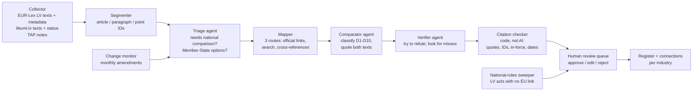

# Feasibility study: comparing EU rules with Latvian law, industry by industry, with AI agents (pilot: agriculture)

*13 October 2026. Research and planning only. Nothing has been built, bought, sent or published, and no one has been contacted.*

> **Newer, simpler plan (13 Oct, later):** the owner's own design is a single person, no lawyer, agents on a rented server, a mix of models, the EU plus about 10 countries, and a one-rule-per-page PDF. The current version is **[`agent-setup-v2.md`](agent-setup-v2.md)**: an n8n pipeline with a model chosen for each step, about €1,700 cash for the first 3 months in the base case, and about 13 weeks part-time. Read that first. The earlier version is [`agent-stack-plan.md`](agent-stack-plan.md). This document remains the detailed background on sources, risks and certainty.

**The question.** Could a system of AI agents compare EU rules with Latvian law for one industry, find where Latvia deviates, and produce a list of every difference and connection? Start with agriculture. What would it cost, how long would it take, how good would the results be, and how sure could we be? What are the downsides, and how do we prevent them?

**Labels used** (as in the rest of this repository): **Fact** [S###] = read in a source registered in [`research/sources.csv`](../../research/sources.csv). **Calculation** = computed by a script in this folder. **Assumption** = an input we chose. **Interpretation** = our judgement. **Recommendation** = what we suggest. **Unknown** = looked for, not found.

---

## 1. The answer in brief

| Question | Short answer |
|---|---|
| **Can it be done with AI agents?** | **Yes, as an AI-assisted process, not AI alone** (Interpretation). Agents can do the bulk work: collecting texts, matching each EU provision to the Latvian provisions that apply it, drafting the comparison, and building the list of connections. A qualified person must confirm every reported difference. Published tests of commercial legal-AI tools found wrong or unsupported answers in **17–33%** of hard queries [S152]. No one has measured this exact task for EU–Latvian agricultural law (Unknown), so the pilot must measure it. |
| **Setup cost (agriculture pilot)** | **About €63,000 in the base case; range €19,000–€275,000** (Calculation, [`cost_model_results.md`](cost_model_results.md)). **About 98% is people**: the legal reviewer (53–71%), the engineering build and project management. AI usage costs about **€1,000** (€300–€6,600). The range is wide mainly because of the reviewer's hourly rate and how long each finding takes to check. |
| **Start smaller** | A **proof of concept** on 3 sub-domains (about 10 EU acts) costs **about €28,000 (€10,000–€96,000)** and takes 4–6 weeks. It is the first part of the pilot budget, not an extra cost. It tells you whether to continue before most of the money is spent. |
| **Time** | **About 4 months (17 weeks) for the agriculture pilot; 11–25 weeks in the range** (Assumption, §6). Reviewer availability sets the pace, not the AI. A second industry costs about €48,000 in the base case, because most of the build is reused (Calculation). |
| **How good could the results be?** | **Very good on facts, good on classification, limited on legal effect** (Interpretation, §7). Facts are which Latvian provision applies which EU article, with exact quotes and dates; code can check quotes mechanically. Classification (stricter, broader, an option used, missing) is a judgement that the reviewer confirms. Legal effect (what a rule means for a farmer in practice) needs a lawyer and is outside the text-only comparison. |
| **How sure would we be?** | **Measured, not promised.** Every reported difference is human-checked. Missed differences are the real risk, so they are measured by sampling. For example, if the reviewer re-checks 200 random "no difference" results and finds no miss, we can say with 95% confidence that fewer than **1.5%** are missed (Calculation, §7.3). |
| **Why this is more feasible than it sounds** | Much of the matching already exists as public machine-readable data. EUR-Lex lists the Latvian acts notified for each directive: 208 of 270 agriculture directives have at least one [S143]. Latvian acts on likumi.lv name the directives they transpose [S144]. Latvian draft-law explanatory notes ("anotācijas") are open data (CC0, since September 2021). When an act touches EU law, its note has a table comparing it with that law, including a column for **stricter requirements** [S146][S147]. Legal texts are not protected by copyright in Latvia [S151]. |
| **Main downsides** | Silent misses. Stale or incomplete source data (we found examples, §3.3). Regulations have no ready-made mapping. People may over-trust the AI. Rules in practice go beyond the text. Each has a prevention (§8). |
| **Update, 13 Oct** | You confirmed that you mean **rules (laws)**, with differences like overtime pay. Checking that example showed something important. The EU sets **no** overtime pay rate. Latvia's default is **at least 2x**; 1.5x is allowed only under a sector-wide collective agreement [S165][S166]. So "Latvia vs most of Europe" is a comparison with **other countries' laws**, not with EU law. It can be added as an option for about **€3,100 per country** in the base case (§2.5, §5.2). |
| **Recommendation** | Answer the open decisions in §9, then run the proof of concept with clear go/no-go thresholds (§6). Do not commit to the full pilot until the proof of concept has measured recall, review time per finding and reviewer agreement on real data. |

---

## 2. What exactly would be compared

### 2.1 "EU rules" come in different forms, and Latvia can deviate in different ways

| EU instrument | How it reaches Latvia | Where Latvian rules can differ |
|---|---|---|
| **Regulation** (e.g. CAP 2021/2115, Animal Health Law 2016/429) | Applies directly; no transposition | Options the regulation leaves to Member States ("Member States may…"), derogations, penalties, competent authorities, procedures, choices in Latvia's CAP Strategic Plan |
| **Directive** (e.g. Nitrates 91/676, pig welfare 2008/120) | Must be written into Latvian law (transposition) | Stricter rules ("gold-plating"), broader scope, partial or missing transposition, late transposition, different definitions |
| **Delegated / implementing acts** | Mostly apply directly | Detailed national procedures and forms |
| **No EU rule** (national competence) | — | Purely national rules that still bind the industry (e.g. Latvia's fur-farming ban [S157]) |

The Commission itself separates **transposition checks** (is everything there?) from **conformity checks** (is it correct?) [S160]. This project would do both, at provision level.

> **If you meant technical *standards* (EN / LVS EN), this is a different project.** European standards are normally adopted unchanged as Latvian standards (Interpretation). The interesting question is then which standards Latvian law makes mandatory. An open dataset of standards referenced in Latvian law exists [S163], but the standard texts themselves are paid. This study covers **EU legislation**, as the owner confirmed on 13 Oct (§9).

### 2.2 Types of difference (the taxonomy the agents would use)

| Code | Type | Agriculture example |
|---|---|---|
| D1 | **Stricter requirement** than EU law | Latvia's Unfair Trading Practices law applies to **all** supply-chain participants **regardless of turnover** [S155]. The directive protects only suppliers in set turnover bands (up to €350 million) selling to larger buyers, and expressly allows stricter national rules (Art. 1(2), Art. 9(1)) [S164] |
| D2 | **Broader scope** | The same law also covers **non-food retailers'** buying power [S155] |
| D3 | **National option or derogation used** | Latvia is one of 19 Member States that excluded cultivation of GM maize MON 810 from their territory [S158]. Latvia's CAP Plan defines and revises its own GAEC farming standards (wetlands and peatlands, buffer strips, crop changes; amended Nov 2024) [S159] |
| D4 | **Partial or missing transposition** | To check, not assumed: the revised Industrial Emissions Directive 2024/1785 had a 1 July 2026 deadline, and EUR-Lex showed no Latvian measure on 13 Oct 2026 [S143] |
| D5 | **Different definition or term** | (found during the pilot) |
| D6 | **Procedure / competent authority** | (found during the pilot) |
| D7 | **Penalties and enforcement** | (found during the pilot) |
| D8 | **Timing** (late transposition, transitional periods) | (found during the pilot; the D4 check above may turn out to be one) |
| D9 | **Purely national rule** with no EU counterpart | Fur-farming ban [S157]. Overtime pay rate: Latvia requires at least 2x, while the EU sets no rate at all [S165][S166] |
| D10 | **No difference** (faithful) | The fertiliser-law amendment's note says Regulation 2019/1009 is applied with "no stricter requirements" [S147]. This is a ministry's own statement, so it is checked, not trusted |

### 2.3 What "connections" means

Each link in the output is typed. Examples: *transposes* (directive → Latvian provision), *implements option* (regulation article → Latvian choice), *sets penalty for*, *names competent authority*, *amends / replaces* (Latvian act history), *refers to*, *possible conflict*. Together they form a network. You can list it per EU act, per Latvian act or per topic, and you can draw it as a graph.

### 2.4 What you would get at the end (one row per EU provision, per difference)

| Field | Example (illustrative) |
|---|---|
| Industry / sub-domain | Agriculture / supply chain |
| EU provision | Directive (EU) 2019/633, Art. 1 (scope) |
| Latvian provision(s) | Negodīgas tirdzniecības prakses aizlieguma likums, scope article (likumi.lv link) |
| Relation | transposes |
| Difference type | D1 stricter + D2 broader scope |
| What differs (plain language) | Applies to all participants regardless of turnover, while the directive covers suppliers up to €350 million turnover selling to larger buyers; also covers non-food retailers [S155][S164] |
| Evidence | Verbatim quotes from both texts with article IDs; "law as at" date |
| Who is affected | Buyers and suppliers in the agri-food chain; non-food retailers |
| AI confidence / reviewer verdict | e.g. "high" / "confirmed by reviewer, date" |
| Notes | Directive allows stricter national rules, Art. 9(1) [S164]; minimum harmonisation [S156] |

The register is delivered as a spreadsheet/CSV and a small database, plus the connection list and a short summary per sub-domain.

### 2.5 The owner's example: overtime pay (added 13 Oct 2026)

The owner's example was that overtime is paid at about 1.25x "in most of Europe" and 1.5x in Latvia. This is exactly the kind of difference the register should catch. Checking it at source shows three levels:

| Level | What the rule says | Source |
|---|---|---|
| **EU law** | Sets limits, not pay. The average working week is at most 48 hours **including overtime** (Directive 2003/88, Art. 6(b)). Employers must tell workers in writing about "any arrangements for overtime and its remuneration" (Directive 2019/1152, Art. 4(2)(l)). **There is no EU overtime pay rate.** | [S166][S167] |
| **Latvia** | Overtime and public-holiday work earn a supplement of **at least 100%**, so at least **2x** the hourly rate. A sector-wide general collective agreement that substantially raises pay above the minimum wage may lower this, but not below 50%, so **1.5x** (Labour Law s.68, as amended from 1 May 2019) | [S165] |
| **Other countries** (secondary sources, to verify) | **Lithuania:** at least 1.5x; 2x at night or on unscheduled rest days; 2.5x on public holidays (from 2025) [S170]. **Estonia:** time off by default, or 1.5x if paid in money [S171]. **France:** +25% for the first 8 overtime hours a week, then +50%; agreements may set as low as +10% [S169]. **Germany:** no statutory premium; contracts or collective agreements decide [S172] | [S169]–[S172] |

What this means for the project:
1. **Comparison A: Latvia vs EU law** (what the pilot does). Overtime appears three times:
   - Latvia's working-time limits are compared with the 48-hour rule (D1 if stricter).
   - Latvia's duty to inform workers is compared with Directive 2019/1152 (D10 or D4).
   - The 2x pay rate is recorded as a **purely national rule (D9)**, because the EU sets none.
2. **A connection worth knowing.** Articles 3–6, 8, 10 and 13 of Directive 2019/1152 are part of the CAP's **social conditionality** (Regulation 2021/2115, Annex IV) [S168]. A farm employer's duty to give workers written terms, including how overtime is paid, therefore links labour law to CAP payments. How Latvia applies this to payment reductions is something the pilot would check (Unknown now). Because of this link, the scope now includes a farm-employment group of 5 directives ([`pilot-scope-agriculture.md`](pilot-scope-agriculture.md)).
3. **Comparison B: Latvia vs other countries.** "Most of Europe pays 1.25x" compares Latvia with other Member States' national laws, not with EU law. That is a different, additional job, best done as a **parameter matrix**: a fixed list of key rules for the industry, with one cell per country (§5.2). The quick check above shows why it needs verification. Rates range from no statutory premium (Germany) to 2x (Latvia), and Latvia's default is 2x, not 1.5x.

---

## 3. What we found when we looked (evidence gathered in this session)

### 3.1 How big agriculture is

- **Fact** [S142]: the EU's own database classifies about **8,300 acts in force** (8,293) under the agriculture chapter. They include 2,536 implementing regulations, 2,121 regulations, 1,716 addressed decisions and 209 directives. Most of them are market-management and trade acts that do not set rules farmers must follow.
- **Fact** [S142]: important farm rules sit **outside** that chapter. The Nitrates Directive, for example, is filed under environment. Scope therefore has to be built by topic, not by database category.
- **Recommendation**: a **core slice of about 50 base acts** covers what binds farms and agri-businesses: CAP and conditionality, nutrients, plant protection, seeds and GMOs, animal health and welfare, feed and food hygiene, organic, supply chain and state aid. We verified a candidate list of **54 acts, all in force** (26 directives, 28 regulations), including 5 farm-employment directives added after the overtime example (§2.5): [`pilot-scope-agriculture.md`](pilot-scope-agriculture.md). The cost model's base case assumes about 50 acts (range 40–70).

### 3.2 Ready-made links exist and give the agents a head start

| Source | What it gives | Access |
|---|---|---|
| **EUR-Lex national implementing measures** | Which Latvian acts were notified for each directive. 208 of the 270 in-force agriculture directives have at least one Latvian record (428 records in total) [S143] | Public SPARQL endpoint, no key; our queries are in [`data/queries/`](data/queries/) |
| **likumi.lv "Informatīva atsauce"** | Latvian acts that transpose directives list them in a note at the end. For example, MK No. 834 lists the Nitrates Directive and the national-emissions Directive 2016/2284 [S144] | Public website; consolidated texts |
| **TAP explanatory notes (anotācijas)** | Section 5.1 lists the EU acts concerned by CELEX number. Section 5.4, table 1, has four columns: A, the EU article; B, the Latvian provision; C, fully or partly transposed; D, **stricter requirements and why**. There is also a question on how the Member State's discretion was used [S147][S148] | **Open data, CC0**, monthly files from September 2021 to September 2026 [S146] |

### 3.3 These links are incomplete and partly stale, so they are a start, not the answer

- **Repealed acts stay listed.** The list is a history of what was notified, not a picture of current law. EUR-Lex still lists Cabinet Regulation No. 33 of 2011 for the Nitrates Directive [S143], although it lost force on 8 Jan 2015 [S145].
- **Titles are not updated.** The current rules (MK No. 834) appear under their 2014 title [S143]. Their scope was extended to air protection in 2018, and they were amended five times up to March 2026 [S144].
- **Links are coarse.** One 2001 law ("Par piesārņojumu") is notified against **39 directives** as a single record [S143]. That says nothing about which article does what.
- **Regulations have no mapping.** The 28 regulations in the core list have **0** Latvian records [S143], as expected, because regulations are not transposed. National options, penalties and authorities for regulations must be found by search. This is the hardest part of the work (Interpretation).
- **Absence is ambiguous.** 62 of the 270 agriculture directives have no Latvian record [S143]. Many are country-specific (for example, lists of less-favoured areas in other Member States). Others need a human to decide whether they apply.
- **Metadata has quirks.** EUR-Lex gives Directive 2015/412 a transposition date of 17 Oct 2002, which is before the directive existed [S143]. Every date needs a sanity check.
- **Explanatory notes are self-declared.** The ministry writing the law fills in the "stricter requirements" column [S147]. They also exist only for acts processed in TAP since September 2021 [S146]. Older acts need other routes.
- **One government dataset was unreachable.** The Ministry of Justice's "transposed EU acts" file failed with a connection reset from this session [S149].

**A near-miss that shows the main risk.** Our first database query asked for Latvia's measures for the Nitrates Directive through one link field. It returned only two acts, one of them repealed, and it missed the rules actually in force (MK No. 834). The data stores these links in **two** different fields, and only a query on both found everything [S143]. An AI agent can make exactly this kind of error, confidently. That is why the design below always uses several search routes and verifies the results.

### 3.4 Legal and access conditions

- **No copyright obstacle.** Laws, regulations, other official documents, their official translations and official consolidated versions are not protected by copyright in Latvia [S151]. EU legal texts are public through EUR-Lex.
- **likumi.lv** asks users not to harm the portal's security, stability or speed (clause 7) [S150]. So access must be gentle and rate-limited, without bypassing any controls. Its consolidated texts are **informative**; the official publication prevails if they conflict [S150]. Every finding therefore carries a "law as at" date and a link to the official version.

---

## 4. How the agent system would work

| Component | What it does | Kind |
|---|---|---|
| Collector | Downloads the **Latvian-language** versions of EU acts and their metadata (EUR-Lex), Latvian consolidated texts with status and directive references (likumi.lv), and explanatory notes (TAP open data). Everything is stored with dates | Code |
| Segmenter | Splits texts into articles, paragraphs and points with stable IDs | Code |
| Triage agent | Marks EU provisions that need a national comparison, and extracts every "Member States may/shall…" option | Small model (triage); mid-size model (options) |
| Mapper | Finds candidate Latvian provisions through **three independent routes**: official links (EUR-Lex, likumi.lv, TAP table column B), keyword and semantic search, and cross-references inside Latvian acts. It takes the **union** of the three, never the intersection | Search + model |
| Comparator agent | For each EU provision and its candidates: classifies the difference (D1–D10), quotes both texts word for word, explains in plain language, gives a confidence, and may answer "unsure" | Strongest model |
| Verifier agent | A separate pass that tries to **disprove** each finding and to spot differences missed among the "no difference" results | Strongest model, different instructions |
| Citation checker | Rejects any finding whose quotes do not match the source text exactly, whose IDs do not resolve, or whose Latvian act is not in force | Code (deterministic) |
| National-rules sweeper | Finds Latvian agriculture acts that link to no EU act. These are candidates for purely national rules (D9) | Search + model |
| Human review queue | The reviewer approves, edits or rejects each flagged item; every decision is logged | Spreadsheet first, simple web page later |
| Change monitor | Monthly: detects changed EU acts (database modification dates), new Latvian versions and new TAP notes, and re-runs only the affected items | Code + models |

**Design rules** (Recommendation):
1. **Compare Latvian with Latvian.** Use the official Latvian version of each EU act, so that translation does not create false differences. Summaries can be written in English.
2. **Evidence or nothing.** No finding without verbatim quotes, provision IDs and a "law as at" date, all checked by code.
3. **"Unsure" is an allowed answer.** It goes to a human. The system is never forced to guess.
4. **Record "no difference" too.** Faithful transposition is a result, and it is what the recall audit samples.
5. **Measure from day one** against a reviewer-made gold-standard set.
6. **People sign off.** Nothing reaches the final register without reviewer approval.

**Technology** (Assumption): Claude models through the API: Opus 5.5 to compare and verify, Sonnet 5.5 to extract options, Haiku 5.5 for triage. Full passes run through the Batch API at half price [S044]. Storage is SQLite or Postgres plus a search index. The model vendor can be swapped. The costs below use Anthropic's published prices [S044].

---

## 5. Costs

All figures come from [`cost_model.py`](cost_model.py) → [`cost_model_results.md`](cost_model_results.md) (Calculation). Every input except the API prices is an **Assumption**, and each is written in the script so it can be changed.

### 5.1 Agriculture pilot (core slice of about 50 EU acts)

| Item (EUR) | Low | Base | High |
|---|---:|---:|---:|
| Engineering build (20 / 35 / 60 days at €45 / €60 / €85 per hour) | 7,200 | 16,800 | 40,800 |
| Legal expert (170 / 430 / 1,310 hours at €60 / €90 / €150 per hour) | 10,200 | 38,700 | 196,425 |
| Project management / quality checks | 1,485 | 6,390 | 30,422 |
| Hosting and tools | 60 | 200 | 900 |
| AI usage (API) | 323 | 1,033 | 6,631 |
| **Total pilot** | **19,268** | **63,123** | **275,178** |
| Proof of concept (first part of the pilot) | 9,767 | 28,443 | 96,291 |
| Second industry of similar size | 13,004 | 47,799 | 236,106 |
| Upkeep per month after the pilot | 804 | 2,549 | 10,906 |

**Where the reviewer hours go (base case, 430 h):**
- 100 h: building the gold-standard set (200 provisions).
- 210 h: checking about 525 flagged findings, at about 24 minutes each.
- 40 h: the recall audit.
- 40 h: the difference taxonomy and scope.
- 40 h: the sweep for purely national rules.

**Benchmark: the same scope done fully by hand.** About **€164,000 in the base case** (€43,000–€876,000). The AI-assisted pilot is about **55–69% cheaper** (Calculation). The saving comes from less searching and drafting; review is not removed. This comparison rests on our assumption of about 1 hour per relevant EU provision when done manually, so the proof of concept should time some items both ways.

**What the rates rest on.** No survey of Latvian legal fees was found (Unknown). State legal aid pays €30 per hour for a consultation, which is a floor [S162]. A Latvian law firm states that the cost caps used by administrative courts are at least three times below market rates [S162]. The low case (€60/h) fits an in-house lawyer or an academic. The high case (€150/h) fits law-firm rates.

**What moves the total most** (Interpretation, from the model):
1. **The reviewer's hourly rate.**
2. **Review minutes per finding** (15 / 24 / 36).
3. **How many findings the system flags.** A sharper comparator means fewer false alarms to review.

The AI bill barely matters: even three times more tokens than assumed adds only about €2,000 in the base case.

**If you build it yourself** with an AI coding assistant, most of the engineering line becomes your own time, not cash. The reviewer cost stays.

### 5.2 Optional: compare Latvia with other EU countries

This covers rules the EU leaves to each country, such as overtime pay (§2.5). It is a parameter matrix: a fixed list of key rules for the industry. For each rule and country, AI extracts the value from that country's official legal text, and a reviewer who reads that language checks it (Assumptions in `COMPARE` in the model; Calculation):

| | Low | Base | High |
|---|---:|---:|---:|
| Rules in the matrix | 40 | 80 | 150 |
| Reviewer minutes per cell | 10 | 15 | 25 |
| **Cost per added country (EUR)** | **832** | **3,110** | **13,822** |
| 3 countries (e.g. Estonia, Lithuania, Poland) | 2,497 | 9,329 | 41,466 |
| All 26 other Member States | 21,643 | 80,852 | 359,371 |

- **Latvia's own column** comes mostly from the main register. Rules not already covered there count as one more country.
- **The hard part is people.** You need a reviewer for each country's law and language, and that is harder to find than budget. A cheaper first pass can use EU-level comparative sources, with country experts checking only the disputed cells.
- **A full EU-law comparison** for another country, rather than a matrix, would cost about as much as a new pilot.

---

## 6. Provisional timeline (Assumption)

| Phase | Weeks (low / base / high) | What happens | Output |
|---|---|---|---|
| 0. Decide and prepare | 1 / 2 / 3 | Answer §9. Engage the reviewer. Sign off scope and taxonomy. Set up data access (EUR-Lex, likumi.lv, TAP open data) | Signed scope; review guide |
| 1. **Proof of concept** | 3 / 4 / 6 | 3 sub-domains, 10 EU acts: **nutrients** (Nitrates Directive, Directive 2016/2284, Regulation 2019/1009 ↔ MK No. 834 [S144] and the fertiliser law [S147]); **plant protection** (Regulation 1107/2009, Directive 2009/128); **farm-animal welfare** (5 directives). Gold set of about 200 provisions. Pipeline v1. Measure | Gate 1 report: measured recall, precision, review time, reviewer agreement |
| 2. Scale to the full core slice | 5 / 8 / 12 | The other ~40 acts; option catalogue for the regulations; national-rules sweep; review queue | Draft register + connections |
| 3. Audit and deliver | 2 / 3 / 4 | Random "no difference" audit; blind second-reviewer subset; fixes; known-limits note; set up the monthly update | **Final register for agriculture** |
| **Total** | **11 / 17 / 25** | | |

**Gate 1, at the end of the proof of concept** (Recommendation). Continue only if all of the following hold:
- 100% of quotes and IDs pass the code check.
- Recall on the gold set's known differences is at least 90%, with the lower bound of the 95% interval at least 80%. This needs about 60 or more real differences in the gold set (§7.3).
- At least 60% of flagged items are real differences, so review stays affordable.
- Review takes 30 minutes or less per flagged item.
- The two reviewers agree well (Cohen's κ ≥ 0.6).

If a threshold fails: fix it and re-measure once, narrow the scope, or stop. Stopping after the proof of concept costs about €10,000–€28,000 in the low and base cases.

---

## 7. How good could the results be, and how sure would we be?

### 7.1 What published evidence says

- **Fact:** commercial legal research tools hallucinated on **17–33%** of the test queries in a peer-reviewed Stanford study. That was fewer than general-purpose GPT-4, but far from error-free [S152]. These were US case-law tools from 2024.
- **Fact:** in a 2025 industry benchmark, some legal AI tools beat a lawyer baseline on **data extraction**: 73.2% and 75.1%, against 71.1% for lawyers. No AI tool beat lawyers on one research task [S153]. *Interpretation:* extraction-like work is where AI does best, and this project is mostly extraction and matching.
- **Fact:** a 2025 study used an earlier Claude model to align legal concepts in national implementing laws with an EU act. The concepts it flagged as missing were confirmed by expert annotators, and the authors kept experts in the loop [S154]. This is the closest published analogue to this task.
- **Fact:** frontier models work in Latvian, though performance varies a lot between models [S161]. No Latvian **legal** benchmark was found (Unknown).
- **Interpretation:** current models are stronger than those tested, but nothing published measures EU–Latvian agricultural law. The honest position is to treat quality as **unknown until the proof of concept measures it**, and to design so that errors are caught.

### 7.2 Expected quality by layer (Interpretation; targets are Recommendations)

| Layer | Example | Expected | How we would know |
|---|---|---|---|
| **Facts**: provision text, IDs, in force, dates | "MK No. 834 applies Directive 91/676; in force since 8 Jan 2015" | **High**: quotes and IDs are checked by code, not trusted | Automated checks; target 100% pass |
| **Mapping completeness**: were all relevant Latvian provisions found? | All national rules applying Regulation 1107/2009's options | **Good for directives** (several seeded routes); **weaker for regulations** (search only) | Recall on the gold set; random audit |
| **Classification**: stricter, broader, option used, missing, same | "The UTP law is stricter in scope" | **Medium**: the AI drafts, the reviewer decides | Blind second-reviewer agreement (κ) |
| **Legal effect in practice**: inspection practice, guidance, case law | "How PVD actually enforces it" | **Low** from text alone; outside the core scope unless a lawyer adds it | Not claimed |

### 7.3 How sure: the statements we could make at the end (Calculation)

- **Precision.** Every difference in the final register was confirmed by a named reviewer on a stated date. Precision is therefore close to 100%, limited only by the reviewer's own error rate, which the second-reviewer sample measures.
- **Missed differences.** The reviewer re-checks a random sample of "no difference" results:

| "No difference" items re-checked, 0 misses found | We can say, with 95% confidence, that the miss rate is below |
|---:|---:|
| 100 | 3.0% |
| 200 | 1.5% |
| 300 | 1.0% |

- **Recall on the gold set.** If the system finds 90% of the known differences, the 95% interval for true recall is 83–94% with 100 real differences in the gold set, 80–95% with 60, and 70–97% with only 20. So the gold set must contain enough real differences.

The final register would carry a plain statement such as: *"Law as at 1 March 2027. 1,500 EU provisions compared. 420 differences, each confirmed by [reviewer]. Random audit of 200 'no difference' results found 0 misses (95% upper bound on misses: 1.5%). Second-reviewer agreement κ = 0.74."* (illustrative numbers).

### 7.4 What the register would *not* tell you

The register would not cover:
- court rulings (CJEU, Latvian courts);
- inspection and enforcement practice;
- agency guidance (Rural Support Service LAD, Food and Veterinary Service PVD), unless added as sources;
- infringement cases;
- changes after the "law as at" date.

**It is a research aid, not legal advice** (Interpretation).

---

## 8. Negatives and how to prevent them

| # | Risk | Why it happens | Prevention | What remains |
|---|---|---|---|---|
| 1 | **Missed differences** (the silent failure) | Retrieval misses a Latvian provision, or the model judges "same" too quickly | Three mapping routes taken as a union; an "unsure" option; a verifier that hunts for misses; gold-set recall; random audit of "no difference" results (§7.3) | A measured, small miss rate, published with the register |
| 2 | **Invented or wrong citations** | Language models can produce text that sounds right but is wrong | Verbatim quotes required; **code** rejects any quote not found in the source; IDs must resolve | Close to zero for quotes; interpretation errors handled by review |
| 3 | **Stale or wrong source data** | Database lists include repealed acts, old titles and odd dates (§3.3) | Check in-force status of every Latvian act on likumi.lv; "law as at" date; official publication link; date sanity checks | Changes after the date (handled by monthly upkeep) |
| 4 | **Self-declared "no stricter rules"** | Ministries fill in their own explanatory notes [S147] | Treat the notes as claims to test; compare the texts independently | — |
| 5 | **Regulations have no mapping** | Not transposed, so no notification [S143] | Option extraction ("Member States may…") plus a search for national rules naming the regulation; extra gold-set weight on regulations | Lower recall here; reported separately |
| 6 | **Translation and terminology drift** | Comparing English EU text with Latvian law | Compare the official Latvian EU version with Latvian law; keep a glossary | Genuine differences in terms are findings (D5), not noise |
| 7 | **Over-trust by reviewers** ("automation bias") | People accept confident AI drafts | Blind-review a subset without seeing the AI verdict; a second reviewer; track how often reviewers overturn the AI | Measured through agreement statistics |
| 8 | **Scope creep / unclear "industry"** | Agriculture touches environment, food, trade, tax and labour law | A signed scope list (the 49-act start in [`pilot-scope-agriculture.md`](pilot-scope-agriculture.md)); changes go through the change log | — |
| 9 | **Liability if others rely on it** | Users may treat the register as legal advice | Disclaimer; reviewer sign-off; "law as at" date; if sold, professional review and terms of use | Needs a decision on purpose (§9) |
| 10 | **Website access problems** | Portals limit automated traffic [S150]; one government file was unreachable [S149] | Open data first (EUR-Lex SPARQL, TAP CC0); slow polite collection; no bypassing; cache everything | Occasional manual downloads |
| 11 | **Cost overrun** | Review is slower than assumed | The proof of concept measures minutes per finding before scaling; a budget cap per phase | — |
| 12 | **Model or vendor change** | Model versions change over time | Pin model versions; re-run the gold set before any switch | — |
| 13 | **Upkeep burden** | Rules change often (MK No. 834 changed 5 times since 2018 [S144]) | A change monitor re-runs only affected items; about €800–€10,900 per month (§5) | Someone must keep reviewing |

---

## 9. Decisions needed from you

1. ~~What does "European standard rules" mean?~~ **Answered on 13 Oct:** you mean **rules (laws)**, with differences like overtime pay. So the scope is EU legislation plus Latvian national rules; technical standards are out. Your example also raises decision 3.
2. **Who reviews, and what is the register for?**
   - (a) **Internal research or business development.** A capable in-house or academic reviewer is enough; this points to the low or base case.
   - (b) **A product for clients**, for example farmers, advisers or agri-businesses. This needs a practising lawyer, terms of use and probably insurance; it points to the high case.

   The answer moves the cost more than anything else does.
3. **Should Latvia also be compared with other countries (§2.5, §5.2)? If so, which, and on which rules?** For example, Estonia, Lithuania and Poland on 40–80 key farm rules: overtime pay, working-time limits, seasonal work, fertiliser limits, buffer strips, stocking densities. The base case is about €9,300 for 3 countries.

Nothing has been spent and no one has been contacted. Engaging a reviewer, buying API credits or contacting anyone needs your approval of that specific action.

---

## 10. Files and how to reproduce

| File | What it is |
|---|---|
| [`README.md`](README.md) | This study |
| [`cost_model.py`](cost_model.py) → [`cost_model_results.md`](cost_model_results.md) / `.csv` | Costs, effort, timeline inputs, upkeep, other-country add-on, certainty tables (`python3 feasibility/eu-lv-regulatory-comparison/cost_model.py`) |
| [`pilot-scope-agriculture.md`](pilot-scope-agriculture.md) ← [`build_scope.py`](build_scope.py) | The 54 verified core EU acts, grouped, with Latvian record counts and the proof-of-concept selection |
| [`data/queries/*.rq`](data/queries/), [`data/run_queries.sh`](data/run_queries.sh), [`data/results/`](data/results/) | The EUR-Lex SPARQL queries and their results (retrieved 2026-10-13) |
| [`../../research/sources.csv`](../../research/sources.csv) | Sources S142–S172 added for this study (S044 = API prices) |

Rebuild: `bash feasibility/eu-lv-regulatory-comparison/data/run_queries.sh && python3 feasibility/eu-lv-regulatory-comparison/build_scope.py && python3 feasibility/eu-lv-regulatory-comparison/cost_model.py`
